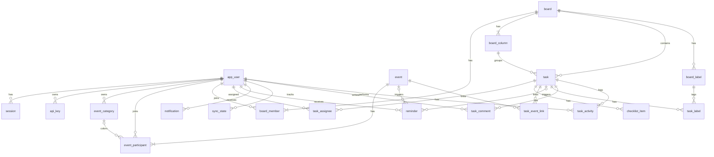

# Модель данных

Схема PostgreSQL для MVP. Точные типы и индексы фиксируются в моделях SQLAlchemy, а с этапа 8 в миграциях Alembic.

## Общие правила

- Первичный ключ — `uuid`, значение генерирует приложение или клиент. Исключения указаны отдельно.
- Все моменты времени имеют тип `timestamptz`, даты без времени — `date`.
- Во всех таблицах есть `created_at`. В изменяемых таблицах есть ещё `updated_at`. В описании ниже эти поля опущены, если не важны.
- Каскадных удалений нет. Пользователи только блокируются, события, задачи и комментарии удаляются мягко через `deleted_at`, доски архивируются. Физически удаляются только колонки и метки, правила описаны в их разделах.
- Таблица пользователей называется `app_user`, потому что `user` — зарезервированное слово PostgreSQL.

## Схема связей



## Идентификация

### `app_user`

| Поле | Тип | Описание |
|---|---|---|
| `id` | uuid | |
| `login` | text, unique | Логин в нижнем регистре |
| `display_name` | text | Отображаемое имя |
| `password_hash` | text | Argon2id |
| `must_change_password` | bool | Обязательная смена пароля при входе |
| `timezone` | text | IANA-зона, например `Europe/Moscow` |
| `color` | text | Цвет аватара |
| `status` | enum | `active`, `blocked` |

При создании пользователя в одной транзакции появляются три категории «Личное», «Работа» и «Учёба», личная доска с двумя колонками и строки `sync_state`.

### `session`

| Поле | Тип | Описание |
|---|---|---|
| `id` | uuid | |
| `user_id` | uuid, FK | |
| `token_hash` | text, unique | SHA-256 от токена |
| `user_agent` | text | Для справки |
| `last_seen_at` | timestamptz | Пишется не чаще раза в минуту |
| `expires_at` | timestamptz | Продлевается при использовании |
| `revoked_at` | timestamptz, null | |

### `api_key`

| Поле | Тип | Описание |
|---|---|---|
| `id` | uuid | |
| `user_id` | uuid, FK | Владелец, ключ не шире его прав |
| `name` | text | Например, `ada` |
| `prefix` | text | Видимая часть ключа для опознания |
| `key_hash` | text, unique | SHA-256 от секрета |
| `scopes` | text[] | Например, `{events:read,tasks:read}` |
| `expires_at` | timestamptz, null | `NULL` — бессрочный |
| `last_used_at` | timestamptz, null | Пишется не чаще раза в минуту |
| `revoked_at` | timestamptz, null | |

### `login_attempt`

| Поле | Тип | Описание |
|---|---|---|
| `login` | text | Часть первичного ключа |
| `ip` | inet | Часть первичного ключа |
| `failed_count` | int | |
| `last_failed_at` | timestamptz | |
| `blocked_until` | timestamptz, null | Растущая пауза |

### `audit_log`

| Поле | Тип | Описание |
|---|---|---|
| `id` | bigserial | |
| `at` | timestamptz | |
| `actor` | text | Кто запустил CLI |
| `action` | text | Например, `user.create`, `key.revoke` |
| `target_type`, `target_id` | text, uuid | |
| `details` | jsonb | Без секретов |

## Календарь

### `event_category`

| Поле | Тип | Описание |
|---|---|---|
| `id` | uuid | |
| `user_id` | uuid, FK | Владелец, категория личная |
| `name` | text | Уникально в пределах пользователя |
| `color` | text | Ключ цвета из палитры |
| `position` | int | Порядок в списке |

### `event`

| Поле | Тип | Описание |
|---|---|---|
| `id` | uuid | |
| `created_by` | uuid, FK | Справочное поле, прав не даёт |
| `title` | text | |
| `description`, `location` | text, null | |
| `all_day` | bool | |
| `start_at`, `end_at` | timestamptz, null | Первый экземпляр события со временем |
| `start_date`, `end_date` | date, null | Первый экземпляр события на весь день, `end_date` включительно |
| `timezone` | text | IANA-зона, в которой событие создано |
| `recurrence_rule` | text, null | RRULE, у разового события `NULL` |
| `series_end_at` | timestamptz, null | Конец последнего экземпляра, у бесконечной серии `NULL`. Служебное поле для отбора по периоду |
| `version` | int | Счётчик для обнаружения конфликтов |
| `deleted_at` | timestamptz, null | |

Поля `recurrence_rule` и `series_end_at` появятся на этапе 5 вместе с сериями.

Для события на весь день `series_end_at` считается как 00:00 UTC следующего дня после конца последнего экземпляра. Запрос периода расширяет окно на день в обе стороны, а точный отбор выполняется после развёртки.

```sql
CHECK (
  (all_day AND start_date IS NOT NULL AND end_date IS NOT NULL
       AND end_date >= start_date AND start_at IS NULL AND end_at IS NULL)
  OR
  (NOT all_day AND start_at IS NOT NULL AND end_at IS NOT NULL
       AND end_at > start_at AND start_date IS NULL AND end_date IS NULL)
)
```

### `event_participant`

Создатель события тоже хранится здесь.

| Поле | Тип | Описание |
|---|---|---|
| `event_id` | uuid, FK | Часть первичного ключа |
| `user_id` | uuid, FK | Часть первичного ключа |
| `category_id` | uuid, FK, null | Личная категория участника |
| `added_by` | uuid, FK | |

Составной внешний ключ `(user_id, category_id)` не даёт поставить чужую категорию.

## Задачи

### `board`

| Поле | Тип | Описание |
|---|---|---|
| `id` | uuid | |
| `name` | text | |
| `description` | text, null | |
| `icon` | text | Ключ иконки |
| `default_view` | enum | `list` или `kanban`, вид при первом открытии доски |
| `is_default` | bool | Личная доска пользователя, не архивируется |
| `created_by` | uuid, FK | |
| `version` | int | |
| `archived_at` | timestamptz, null | Архивная доска доступна только для чтения, её задачи скрыты из общих списков и календаря |

Частичный уникальный индекс: одна доска `is_default` на пользователя.

### `board_member`

| Поле | Тип | Описание |
|---|---|---|
| `board_id` | uuid, FK | Часть первичного ключа |
| `user_id` | uuid, FK | Часть первичного ключа |
| `role` | enum | `owner`, `editor`, `viewer` |

Доска считается совместной, если в ней больше одного участника. Отдельного признака нет. При удалении участника с доски снимаются его назначения на задачах этой доски.

### `board_column`

| Поле | Тип | Описание |
|---|---|---|
| `id` | uuid | |
| `board_id` | uuid, FK | |
| `name` | text | |
| `position` | text `COLLATE "C"` | Ключ дробной индексации |
| `is_done` | bool | Завершающая колонка |

Уникальность `(board_id, id)` нужна для составного внешнего ключа из `task`, а уникальность `(board_id, position)` страхует порядок колонок. На доске всегда есть хотя бы одна завершающая и одна незавершающая колонка.

Колонка удаляется физически, после того как все её карточки, включая мягко удалённые, перенесены в другую колонку. История ссылается на названия снимком, поэтому от удаления не страдает.

### `task`

| Поле | Тип | Описание |
|---|---|---|
| `id` | uuid | |
| `board_id` | uuid | |
| `column_id` | uuid | Составной FK `(board_id, column_id)` не даёт карточке попасть в чужую колонку |
| `title` | text | |
| `description` | text, null | |
| `priority` | smallint | От 1 до 4, по умолчанию 3 |
| `position` | text `COLLATE "C"` | Ключ дробной индексации |
| `start_date` | date, null | Начало периода актуальности |
| `due_date` | date, null | Дедлайн без времени |
| `due_at` | timestamptz, null | Дедлайн со временем |
| `completed_at` | timestamptz, null | Ставится при переносе в завершающую колонку и очищается при переносе из неё |
| `created_by` | uuid, FK | |
| `version` | int | |
| `deleted_at` | timestamptz, null | |

`CHECK (NOT (due_date IS NOT NULL AND due_at IS NOT NULL))`: дедлайн задаётся одним из двух полей.

### `task_assignee`

| Поле | Тип | Описание |
|---|---|---|
| `task_id` | uuid, FK | Часть первичного ключа |
| `user_id` | uuid, FK | Часть первичного ключа. Должен быть участником доски |
| `assigned_by` | uuid, FK | |

### `checklist_item`

| Поле | Тип | Описание |
|---|---|---|
| `id` | uuid | |
| `task_id` | uuid, FK | |
| `text` | text | |
| `is_done` | bool | |
| `position` | text `COLLATE "C"` | |

### `task_event_link`

| Поле | Тип | Описание |
|---|---|---|
| `task_id` | uuid, FK | Часть первичного ключа |
| `event_id` | uuid, FK | Часть первичного ключа |

Связь видна только тому, у кого есть доступ и к задаче, и к событию.

### `board_label`

| Поле | Тип | Описание |
|---|---|---|
| `id` | uuid | |
| `board_id` | uuid, FK | Метка принадлежит доске |
| `name` | text | Уникально в пределах доски |
| `color` | text | Ключ цвета из палитры |

Метка удаляется физически вместе со связями `task_label`. На карточках, где она стояла, в историю пишется `unlabeled`.

### `task_label`

| Поле | Тип | Описание |
|---|---|---|
| `task_id` | uuid, FK | Часть первичного ключа |
| `label_id` | uuid, FK | Часть первичного ключа. Метка должна быть с той же доски, что и карточка |

### `task_comment`

| Поле | Тип | Описание |
|---|---|---|
| `id` | uuid | |
| `task_id` | uuid, FK | |
| `author_id` | uuid, FK | |
| `body` | text | Простой текст |
| `edited_at` | timestamptz, null | |
| `deleted_at` | timestamptz, null | |

### `task_activity`

Журнал только дополняется, строки не меняются и не удаляются.

| Поле | Тип | Описание |
|---|---|---|
| `id` | bigserial | Задаёт порядок записей |
| `task_id` | uuid, FK | |
| `actor_id` | uuid, FK | Кто выполнил действие. При работе через ключ это его владелец |
| `kind` | enum | Вид записи, список ниже |
| `data` | jsonb | Подробности снимком |
| `created_at` | timestamptz | |

| `kind` | Содержимое `data` |
|---|---|
| `created` | `{"column": "К выполнению"}` |
| `updated` | `{"changes": [{"field": "title", "from": "Старое", "to": "Новое"}, {"field": "description"}]}` |
| `moved` | `{"from_column": "Бэклог", "to_column": "В работе"}`, при смене доски ещё `from_board` и `to_board` |
| `completed`, `reopened` | `{"from_column": "В работе", "to_column": "Готово"}` |
| `assigned`, `unassigned` | `{"user_id": "...", "name": "Саша"}` |
| `labeled`, `unlabeled` | `{"name": "Идея", "color": "blue"}` |
| `checklist_added`, `checklist_checked`, `checklist_unchecked`, `checklist_removed` | `{"text": "Пункт"}` |
| `event_linked`, `event_unlinked` | `{"event_id": "...", "title": "Ужин вдвоём"}` |

Запись о связи с событием отдаётся только участникам этого события: остальные участники доски не узнают ни о связи, ни о названии.

## Уведомления

### `reminder`

| Поле | Тип | Описание |
|---|---|---|
| `id` | uuid | |
| `user_id` | uuid, FK | Напоминание личное |
| `event_id` | uuid, FK, null | |
| `minutes_before` | int, null | Для события |
| `task_id` | uuid, FK, null | |
| `remind_at` | timestamptz, null | Для задачи, абсолютный момент |
| `next_fire_at` | timestamptz, null | Следующее срабатывание, `NULL` — больше не сработает |

```sql
CHECK (
  (event_id IS NOT NULL AND minutes_before IS NOT NULL
       AND task_id IS NULL AND remind_at IS NULL)
  OR
  (task_id IS NOT NULL AND remind_at IS NOT NULL
       AND event_id IS NULL AND minutes_before IS NULL)
)
```

Уникальность: `(user_id, event_id, minutes_before)` и `(user_id, task_id)`.

### `notification`

| Поле | Тип | Описание |
|---|---|---|
| `id` | uuid | |
| `user_id` | uuid, FK | Получатель |
| `kind` | enum | Список видов в [frontend.md](frontend.md#8-подписи-и-перечисления) |
| `actor_id` | uuid, FK, null | Кто совершил действие, у напоминаний `NULL` |
| `title` | text | Снимок названия объекта на момент уведомления |
| `event_id`, `task_id`, `board_id` | uuid, FK, null | Цель перехода |
| `data` | jsonb | Подробности, например `occurrence_start` и новое время |
| `dedupe_key` | text, unique, null | Защита от дублей при работе worker |
| `read_at` | timestamptz, null | |

Прочитанные уведомления удаляются через 90 дней.

### `sync_state`

| Поле | Тип | Описание |
|---|---|---|
| `user_id` | uuid, FK | Часть первичного ключа |
| `scope` | enum | Часть первичного ключа: `calendar`, `tasks`, `notifications` |
| `version` | bigint | Растёт при каждом изменении, затронувшем пользователя |

## Индексы

| Таблица | Индекс | Зачем |
|---|---|---|
| `event_participant` | `(user_id, event_id)` | Календарь пользователя |
| `event` | `(series_end_at)` | Отбор по периоду, появится на этапе 5 |
| `reminder` | `(next_fire_at) WHERE next_fire_at IS NOT NULL` | Очередь worker |
| `task` | `(board_id, column_id, position)` | Порядок карточек |
| `task` | `UNIQUE (column_id, position) WHERE deleted_at IS NULL` | Страховка от одинаковых ключей |
| `task_label` | `(label_id)` | Фильтр по метке |
| `task_comment` | `(task_id, created_at)` | Комментарии карточки |
| `task_activity` | `(task_id, id DESC)` | История карточки |
| `task` | `(due_date)`, `(due_at)` | Сроки и календарь |
| `task_assignee` | `(user_id)` | «Назначенные мне» |
| `board_member` | `(user_id)` | Доступные доски |
| `notification` | `(user_id, created_at DESC)` | Центр уведомлений |
| `notification` | `(user_id) WHERE read_at IS NULL` | Счётчик непрочитанных |
